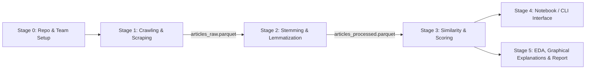

# Wikipedia Recommender System — Project Plan

> **Course:** Information Retrieval (`[IR]`) — Poznan University of Technology  
> **Instructor:** Grzegorz Miebs (`grzegorz.miebs@cs.put.poznan.pl`)  
> **Deadline:** 16 days after the 4th lab (email subject must start with `[IR]`)  
> **Team Size:** 2 students (collaborative GitHub repository)  
> **Target Corpus:** English Wikipedia or an English Fandom Wiki (>= 1,000 articles)

---

## 1. Project Goal & Grading Rules

The goal is to build a content-based recommender system that takes a **collection of previously visited wiki articles** (provided as **URLs/links** or **article titles**) and outputs a **ranked collection of similar recommended articles** (links or titles) together with a numerical **recommendation score**.

### Grading Mechanics
Each of the **three core technical stages** receives its own separate grade:
1. **Crawling and Scraping** (>= 1,000 articles)
2. **Stemming and Lemmatization** (preprocessed corpus saved to `.parquet`/`.csv` or database)
3. **Similarities and Recommendation** (matching user history against the corpus and scoring candidates)

> [!IMPORTANT]
> **Completeness Rule:** The highest possible score without finishing **all** parts is **4.0** (for example, completing only the first two steps perfectly yields `4.0, 4.0, 2.0`). Every obligatory stage **must** be completed end-to-end before spending time on optional extensions.

### Final Deliverables
1. **Source Code** — clean, reproducible repository with easy input/output usage.
2. **Report** (`.pdf` or Jupyter `.ipynb` notebook) containing:
   - Detailed explanation of every pipeline step, **especially the article scoring formula**.
   - Corpus statistics and visualizations (most frequent words, length histograms, document similarity distributions, etc.).
   - Concrete recommendation examples with explanations (**graphical prediction breakdowns** are explicitly preferred by the instructor).

---

## 2. Pipeline Architecture



---

## 3. Project Stages & Task Breakdown

Every stage below separates **Obligatory Tasks** (required for full completion of the assignment) from **Non-Obligatory / Optional Tasks** (explicitly marked optional in `Project-Wiki.pdf` or bonus enhancements for higher grades).

---

### Stage 0: Repository Setup, Environment & Data Contracts

#### Obligatory Tasks
- [ ] Initialize shared Git repository on GitHub and grant collaborator access to both teammates.
- [ ] Standardize on Python `>=3.14` and manage dependencies in `pyproject.toml` (plus lockfile via `uv` or `pip`).
- [ ] Agree on shared file schemas (`data/raw/articles_raw.parquet` and `data/processed/articles_processed.parquet`) so Stage 1, Stage 2, and Stage 3 can be developed in parallel.
- [ ] Configure `.gitignore` so large raw scrapes and local virtual environments are not accidentally pushed to GitHub.

#### Non-Obligatory / Optional Tasks
- [ ] Set up GitHub Actions CI (`pytest` + `ruff` linter on pull requests).
- [ ] Configure `pre-commit` hooks for formatting and notebook output stripping.

---

### Stage 1: Crawling & Scraping *(Graded Step 1)*

#### Obligatory Tasks
- [ ] Select corpus scope: **English Wikipedia** (e.g., seeded across 5–10 distinct topics so recommendations and cross-topic boundaries are clear to test) or a rich **English Fandom Wiki** with >= 1,000 substantive content articles.
- [ ] Build a crawler/scraper (`src/wiki_recommender/crawler/`) that collects **at least 1,000 unique articles**.
- [ ] Extract clean article content for each page:
  - Canonical `url`
  - Exact article `title`
  - Clean `raw_text` (main article body without navigation menus, edit links, tables of contents, reference lists, or footer boilerplate)
- [ ] Enforce polite crawling practices:
  - Custom descriptive `User-Agent` header (required by Wikimedia API / robot policies)
  - Rate limiting / request throttling and retry backoff
  - URL canonicalization and deduplication
  - Filtering out non-article namespaces (`Special:`, `Category:`, `File:`, `Talk:`), disambiguation pages, and ultra-short stubs (e.g., `< 100` words)
- [ ] Save scraped output to `data/raw/articles_raw.parquet` (or `.csv`).

#### Non-Obligatory / Optional Tasks
- [ ] **Using Scrapy** — *explicitly stated in the assignment PDF: "Scrapy is not a must"*. Lighter tools (`requests`/`httpx` + `BeautifulSoup4`, or the official MediaWiki Action/REST API) are completely acceptable.
- [ ] Asynchronous concurrent fetching (`httpx.AsyncClient` / `aiohttp`) with bounded semaphore rate limits.
- [ ] Scraping extra structural metadata for hybrid recommendations and richer report statistics:
  - Article `categories`
  - Outgoing internal wiki `links`
  - Section headings or lead-paragraph (`summary`) separation
- [ ] Scaling the corpus beyond the minimum (e.g., **3,000–10,000 articles**) for denser topic coverage.

---

### Stage 2: Text Preprocessing — Stemming & Lemmatization *(Graded Step 2)*

#### Obligatory Tasks
- [ ] Clean text artifacts left from wiki pages (citation brackets like `[1]`, leftover markup, URLs, non-textual symbols, excessive whitespace).
- [ ] Tokenize documents, normalize case, and remove English stopwords and pure punctuation/numeric noise.
- [ ] Implement **stemming** (e.g., NLTK `SnowballStemmer("english")` or `PorterStemmer`) and **lemmatization** (e.g., `spaCy` `en_core_web_sm` or NLTK `WordNetLemmatizer` with POS tags).
- [ ] Transform the corpus into the most suitable preprocessed representation for retrieval (and justify the choice of lemmatization vs. stemming in the report).
- [ ] Persist the preprocessed dataset to **`data/processed/articles_processed.parquet`** or **`.csv`** (`.parquet` via `pyarrow` is recommended for compact size and preserving token lists).

#### Non-Obligatory / Optional Tasks
- [ ] **Storing the dataset in a database** (SQLite, PostgreSQL, DuckDB, MongoDB, ChromaDB) — *the assignment specifies `.csv`/`.parquet` **or** a database, so a standalone database engine is not required if `.parquet` or `.csv` is used*.
- [ ] Keeping **both** `stemmed_text` and `lemmatized_text` columns in `articles_processed.parquet` to benchmark their recommendation quality side-by-side in the report.
- [ ] Bigram / keyphrase detection (e.g., keeping `"machine_learning"` or `"world_war"` together via `scikit-learn` `ngram_range=(1, 2)` or `gensim` `Phrases`).
- [ ] Title/lead-paragraph term boosting (preserving separate processed fields for title/summary vs. full body).

---

### Stage 3: Similarities & Recommendation Engine *(Graded Step 3)*

#### Obligatory Tasks
- [ ] Support **both input formats** seamlessly:
  - A list of **article titles** (with case-insensitive / normalized lookup)
  - A list of **article URLs/links** (normalized to match stored URLs or titles)
- [ ] Build document vector representations over the preprocessed corpus (e.g., **TF-IDF** matrix with sublinear term frequency scaling via `scikit-learn`).
- [ ] Compute document-to-document similarity (e.g., **cosine similarity**).
- [ ] Define and implement a clear **multi-article scoring algorithm** when the user provides a history of $m \ge 1$ visited articles $V = \{v_1, \dots, v_m\}$:
  - Example baseline: **Centroid / Mean Profile Scoring** (average L2-normalized TF-IDF vector of visited articles compared via cosine similarity to every candidate article $c \notin V$), or **Mean/Max Pairwise Similarity** across $v \in V$.
- [ ] **Exclude already-visited input articles** ($V$) from the returned recommendation list.
- [ ] Return top-$k$ recommended articles containing:
  - Recommended article **title** and **link/URL**
  - Numerical **recommendation score** (clearly bounded and interpretable, e.g., `[0.0, 1.0]`)

#### Non-Obligatory / Optional Tasks
- [ ] **On-the-fly fallback for unseen input links/titles**: if a user inputs a valid Wikipedia URL/title that is not among the 1,000+ local articles, fetch and preprocess that single page on the fly so the system can still recommend matches from the local database.
- [ ] Comparing multiple multi-article aggregation strategies (mean profile centroid vs. max-similarity for multi-interest histories vs. recency-weighted history).
- [ ] Alternative / advanced retrieval models for comparison:
  - **BM25** lexical ranking (`rank-bm25`)
  - **Latent Semantic Analysis (LSA / `TruncatedSVD`)** on TF-IDF
  - **Dense semantic embeddings** (`sentence-transformers`, e.g., `all-MiniLM-L6-v2`)
  - **Hybrid scoring** combining text cosine similarity + wiki category/outlink Jaccard similarity
- [ ] Diversity re-ranking (e.g., **Maximal Marginal Relevance — MMR**) so top recommendations aren't near-duplicates.

---

### Stage 4: User Interaction / Entrypoint

#### Obligatory Tasks
- [ ] Provide an **easy, frictionless way** for the instructor to supply any list of visited article links/titles and immediately receive scored recommendations (e.g., a clean interactive cell block at the top of a demonstration Jupyter Notebook **and/or** a simple CLI command / Python helper function `recommend(visited=[...], top_k=10)`).
- [ ] Handle invalid/unknown titles gracefully with clear feedback (e.g., fuzzy title suggestions via `difflib.get_close_matches`).

#### Non-Obligatory / Optional Tasks
- [ ] **Graphical User Interface (GUI) / Web App** — *explicitly stated in the assignment PDF: "GUI not required, notebook or any other reasonable form will be accepted"*. Building a Streamlit, Gradio, or FastAPI web frontend is purely optional polish.

---

### Stage 5: Corpus Statistics, Explainability & Final Report

#### Obligatory Tasks
- [ ] Choose report format: standalone **Jupyter Notebook (`.ipynb`)** with rendered outputs/plots or compiled **PDF report (`.pdf`)** (or export the final notebook cleanly to PDF).
- [ ] **Algorithm & Scoring Explanation**:
  - Document crawling strategy, filtering criteria, and corpus composition.
  - Explain text cleaning, stemming vs. lemmatization choices, and vectorization parameters.
  - Present the **exact mathematical formula** used to score candidate articles from a multi-article history.
- [ ] **Database Statistics & Exploratory Visualizations**:
  - Total articles, vocabulary size (raw vs. after stopword removal vs. after stemming/lemmatization).
  - Top most frequent words / TF-IDF terms across the corpus (bar charts).
  - Histograms of article lengths (word count / token count distributions).
  - Pairwise document similarity statistics (e.g., histogram of pairwise cosine similarities, topic cluster heatmap, or 2D UMAP/PCA projection).
- [ ] **Recommendation Examples with Explanations**:
  - Present several realistic user histories (single-topic history, multi-topic history, niche query) alongside top recommended articles, their scores, and clear explanations of *why* those articles were matched.

#### Non-Obligatory / Strongly Recommended Bonus Tasks
- [ ] **Graphical Prediction / Score Breakdowns** — *explicitly highlighted by the instructor: "I'd prefer graphical form - see prediction breakdowns for example"*:
  - **Term-contribution bar chart**: for a recommended article $c$, plot the top shared weighted terms $w_{t, u} \cdot w_{t, c}$ contributing most to $\text{score}(u, c)$ (similar to SHAP/LIME waterfall or horizontal contribution bars).
  - **Per-visited-article stacked bar chart**: when the user inputs multiple visited articles $[v_1, v_2, v_3]$, decompose each recommended article's score into how much came from $v_1$ vs. $v_2$ vs. $v_3$.
- [ ] Quantitative offline evaluation (e.g., Hold-out Link Prediction Recall@$k$ — checking how often articles actually linked from $v$ appear in top-$k$ recommendations, or Category Overlap Precision@$k$).

---

## 4. Quick-Reference Summary: Obligatory vs. Not Obligatory

| Component / Feature | Status | Notes from `Project-Wiki.pdf` |
| :--- | :--- | :--- |
| Crawl & scrape **>= 1,000** wiki articles | **Obligatory** | English Wikipedia or English Fandom wiki |
| Use the **Scrapy** framework | **Not Obligatory** | *"Scrapy is not a must"* (`requests` + `BS4` or API is fine) |
| Scrape > 1,000 articles & categories/links | **Not Obligatory** | Helpful for richer stats & hybrid scoring |
| Stemming / lemmatization preprocessing | **Obligatory** | Core graded Step 2 |
| Save processed corpus to **`.parquet` or `.csv`** | **Obligatory** | Either file format OR a database is required |
| Use an **SQL / NoSQL / Vector database** | **Not Obligatory** | Optional if `.parquet` or `.csv` is used |
| Accept list of **links or titles** as input | **Obligatory** | Easy input mechanism required |
| Output **links/titles + numerical score** | **Obligatory** | Exclude already-visited articles |
| TF-IDF + Cosine Similarity recommender | **Obligatory** | Core baseline for graded Step 3 |
| BM25 / Embeddings / Hybrid link scoring | **Not Obligatory** | Great extension for comparing scoring methods |
| On-the-fly scraping of unseen input URLs | **Not Obligatory** | Nice usability improvement |
| Easy Notebook or CLI usage | **Obligatory** | Instructor must easily test custom article lists |
| **GUI / Web application** (Streamlit/Gradio) | **Not Obligatory** | *"GUI not required, notebook or any other reasonable form will be accepted"* |
| Report explaining algorithm & scoring | **Obligatory** | `.pdf` or `.ipynb` |
| Database statistics (top words, histograms, similarities) | **Obligatory** | Explicitly listed in Report section |
| Recommendation examples with explanations | **Obligatory** | Explicitly listed in Report section |
| **Graphical prediction breakdowns** | **Recommended Bonus** | *"I'd prefer graphical form - see prediction breakdowns for example"* |

---

## 5. Folder Organization & File Responsibilities

The repository uses Python's standard **`src/` package layout** so core logic stays modular, testable, and cleanly importable inside Jupyter notebooks without path hacks:

```text
Wiki_recommender/
├── .gitignore                        # Ignores virtualenvs, caches, and heavy data files
├── .python-version                   # Pins Python 3.14 for team consistency
├── Project-Wiki.pdf                  # Official project specification
├── README.md                         # Quickstart setup & usage instructions
├── plan.md                           # This staged roadmap & collaboration guide
├── pyproject.toml                    # Package metadata & Python dependencies
│
├── data/                             # Local datasets (contents gitignored except .gitkeep)
│   ├── raw/                          # Output of Stage 1 (e.g., articles_raw.parquet)
│   └── processed/                    # Output of Stage 2 (e.g., articles_processed.parquet)
│
├── src/
│   └── wiki_recommender/             # Shared installable Python package
│       ├── __init__.py
│       ├── crawler/                  # Stage 1: Wiki API / HTML scraper, rate limiter, filters
│       │   └── __init__.py
│       ├── preprocessing/            # Stage 2: Cleaning, tokenization, stemming, lemmatization
│       │   └── __init__.py
│       ├── recommender/              # Stage 3: Vectorizers, similarity engine, score aggregation
│       │   └── __init__.py
│       └── visualization/            # Stage 5: Corpus stat plots & graphical score breakdowns
│           └── __init__.py
│
├── notebooks/                        # Interactive exploration, demo interface & notebook report
│   ├── 01_corpus_eda.ipynb           # (Planned) Database statistics, histograms & word frequencies
│   ├── 02_recommender_demo.ipynb     # (Planned) Easy input interface + graphical breakdowns
│   └── final_report.ipynb            # (Planned) Complete polished report if submitting as notebook
│
├── reports/                          # Exported report PDF and saved static figures
│   └── figures/                      # High-res plots exported for the report
│
└── tests/                            # Unit tests for preprocessing, URL/title matching & scoring
```

### Shared Data Contracts (Interface Between Teammates)

Agreeing on exact column names lets both students work in parallel from day one:

1. **`data/raw/articles_raw.parquet`** *(produced by Stage 1, consumed by Stage 2)*:
   - `article_id` (`str` or `int`): Unique identifier (e.g., Wikipedia page ID or deterministic URL slug)
   - `title` (`str`): Canonical article title (e.g., `"Information retrieval"`)
   - `url` (`str`): Full canonical URL (e.g., `"https://en.wikipedia.org/wiki/Information_retrieval"`)
   - `raw_text` (`str`): Clean plain-text body of the article
   - `categories` (`list[str]`, *optional*): Wiki categories associated with the page
   - `outlinks` (`list[str]`, *optional*): Outgoing internal article titles

2. **`data/processed/articles_processed.parquet`** *(produced by Stage 2, consumed by Stages 3–5)*:
   - Inherits `article_id`, `title`, `url`, `raw_text` (or `word_count: int`)
   - `tokens_lemmatized` (`list[str]`): Cleaned, stopword-filtered lemmatized tokens
   - `tokens_stemmed` (`list[str]`): Cleaned, stopword-filtered stemmed tokens
   - `processed_text` (`str`): Space-joined canonical tokens ready for `TfidfVectorizer`

---

## 6. Two-Student Collaboration & GitHub Workflow

### Suggested Division of Work

| Phase | Student A Focus | Student B Focus |
| :--- | :--- | :--- |
| **Phase 1 (Data & NLP)** | **Stage 1 (`crawler/`)**: Build crawler/scraper, collect >= 1,000 English Wiki articles, produce `articles_raw.parquet`. | **Stage 2 (`preprocessing/`)**: Build cleaning + stemming + lemmatization pipeline (tested first on a 20-article mock sample, then run on `articles_raw.parquet`). |
| **Phase 2 (Modeling & Explainability)** | **Stage 3 (`recommender/`)**: TF-IDF + cosine similarity engine, multi-article score aggregation, title/URL resolver, unit tests. | **Stage 5 (`visualization/` + EDA)**: Corpus statistics plots (word frequencies, histograms, similarity distributions) & **graphical prediction breakdown** charts. |
| **Phase 3 (Integration & Report)** | **Stage 4 & Report**: Algorithm/math write-up, reproducible demo entrypoint, code cleanup. | **Stage 5 & Report**: Qualitative recommendation case studies, visual explanations, final report polishing & submission check. |

### Git & GitHub Conventions
1. **Branching**: Keep `main` always working. Create short-lived feature branches per task:
   - `feat/crawler`
   - `feat/preprocessing`
   - `feat/tfidf-recommender`
   - `feat/prediction-breakdowns`
   - `docs/final-report`
2. **Pull Requests**: Open a PR into `main` when finishing a module so the other teammate can review code and stay familiar with every stage of the algorithm.
3. **Jupyter Notebooks in Git**: Keep heavy reusable functions inside `src/wiki_recommender/` and import them in `notebooks/`. Avoid both teammates editing the exact same `.ipynb` file on separate branches at the same time to prevent JSON merge conflicts.
4. **Sharing Scraped Data**: Since `data/` files are gitignored (or kept small), either:
   - Run the deterministic crawler command locally (`python -m wiki_recommender.crawler`), **or**
   - Attach `articles_raw.parquet` / `articles_processed.parquet` to a private GitHub Release / shared drive so both teammates evaluate on the exact same snapshot.
